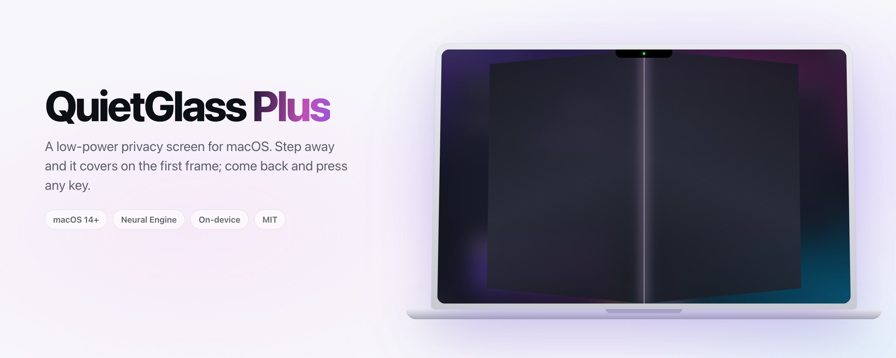
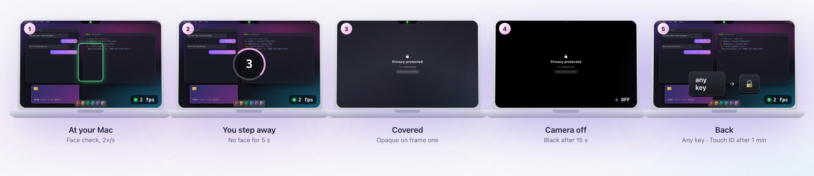
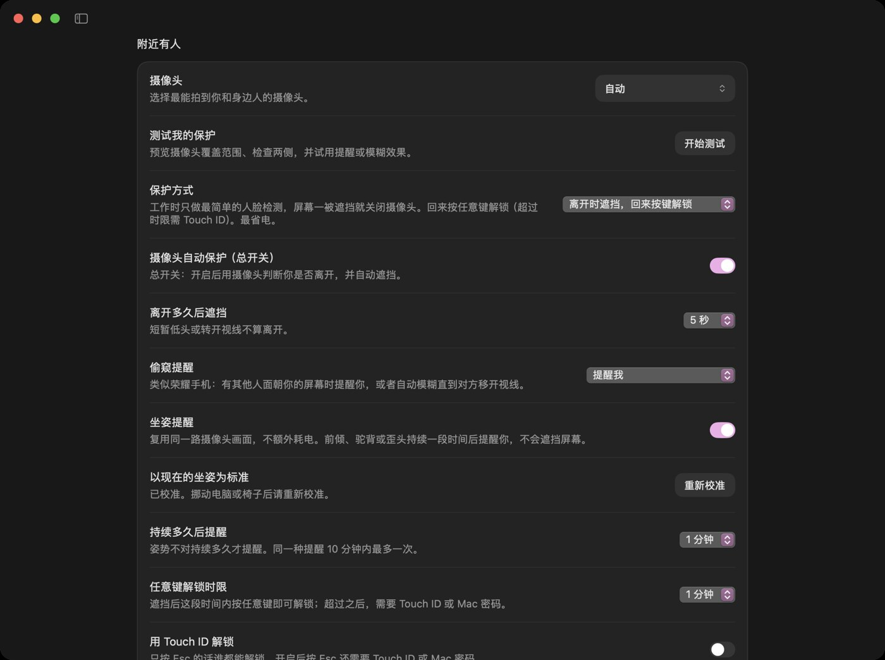
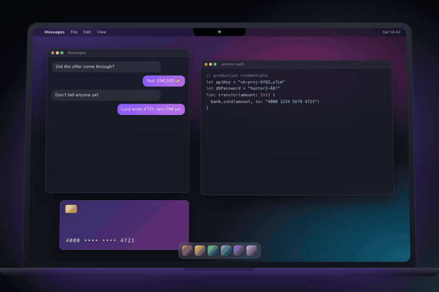
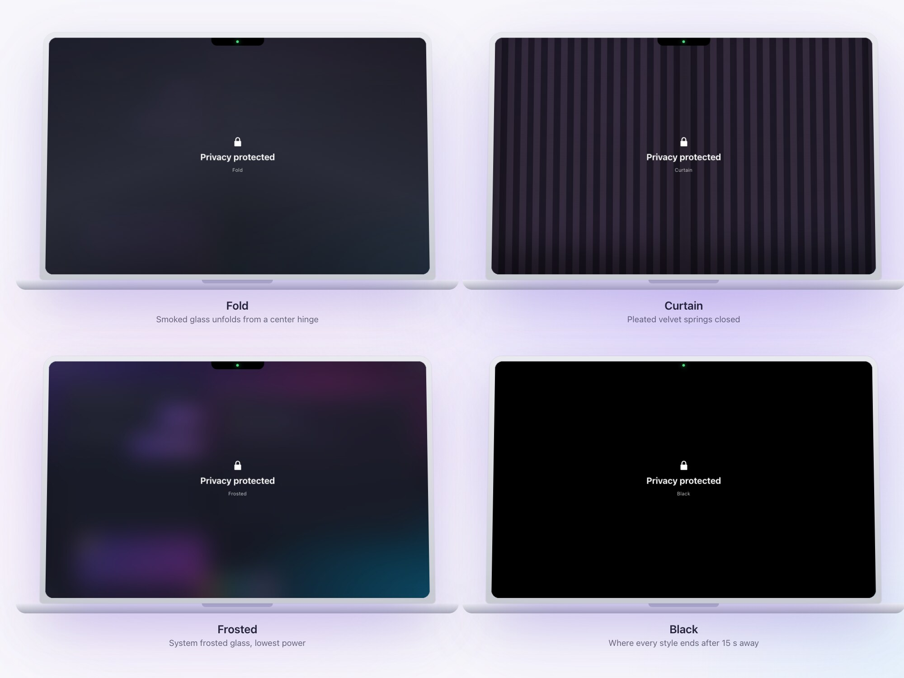
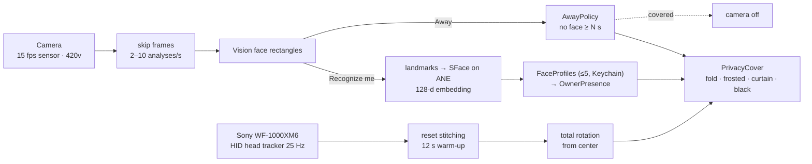
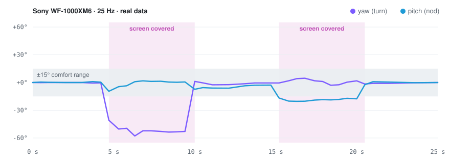
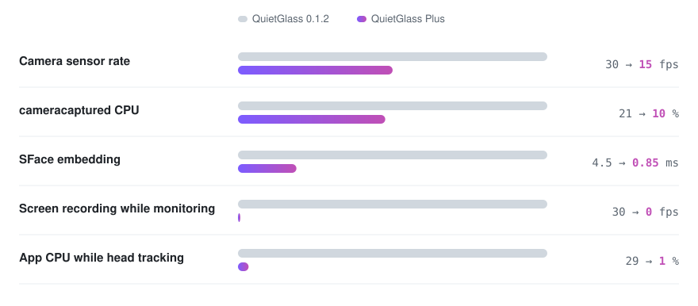

<picture>
  <source media="(prefers-color-scheme: dark)" srcset="media/readme/banner-dark.jpg">
  
</picture>

# QuietGlass Plus

**A low-power privacy screen for macOS that covers your display when you step away — and, if you like, clears only for faces you've saved.**
为 Mac 打造的低功耗隐私屏：离开即遮挡，回来按键解锁；也可以只为你保存的面孔解除。

[**Website & live demo →**](https://functionhx.github.io/quietglass-plus/) · macOS 14+ · Apple silicon recommended · MIT

QuietGlass Plus is a fork of [QuietGlass](https://github.com/clintonimaroo/quietglass) by Clinton Imaro. Upstream is a feature-rich privacy toolkit (window and area blur, sensitive-text detection, AirPods head tracking). This fork keeps all of that and focuses on one job: **running all day in the background without costing battery**, while being harder to switch off for whoever sits down at your Mac.

## Two ways to protect / 两种保护方式

| | **Away** (default) · 离开模式（默认） | **Recognize me** · 识别本人 |
|---|---|---|
| Covers when | no face for 3–30 s (default 5) | you leave, a stranger appears, or an extra face looks on |
| Clears when | any key within a minute; then **Esc** + Touch ID | a saved face is recognized (optional head turn) |
| Camera while you work | face detection only, 2/s | detection + recognition, 3/s steady, 10/s while verifying |
| Camera while covered | **off** | on, waiting for you |
| Recognition model | not loaded | SFace on the Neural Engine |

<picture>
  <source media="(prefers-color-scheme: dark)" srcset="media/readme/away-flow-dark.jpg">
  
</picture>

Away mode, step by step: the camera only asks *is there a face?* twice a second. After 5 s with nobody in view the screen is covered and the camera switches off. Within the first minute any key unlocks; after that, Esc plus Touch ID (both limits are adjustable).

Either mode can lock macOS after N minutes away. Head tracking (look away → cover) works with the camera, AirPods, or Sony/Android head-tracker earbuds.

### Also in away mode / 离开模式附带

- **Peek alert (偷窥提醒).** Like Honor phones: when someone else faces your screen for a moment, a pill appears below the notch — or the screen blurs until they look away. It reuses upstream's facing-screen policy, so people walking past don't trigger it.
- **Posture reminders (坐姿提醒).** A laptop camera rarely sees your shoulders, so posture comes from your face relative to a calibrated baseline: it grows when you lean in, sinks when you slump, rolls when you tilt your head. A problem has to last a minute, reminders repeat at most every ten minutes, and they never cover the screen. Both features reuse the same camera frames, so they cost nothing extra.

<p align="center"></p>

## Covers / 遮挡效果

<p align="center"></p>

<picture>
  <source media="(prefers-color-scheme: dark)" srcset="media/readme/covers-dark.jpg">
  
</picture>

Every style is opaque on its first frame — the animation plays over a screen that is already hidden. *Captured blur* (upstream's adjustable blur, which needs screen recording) remains available for manual, window and area protection.

## How it works / 原理



- **Covers never capture the screen.** `PrivacyCover` is a borderless panel above everything (including the notch controls) whose frosted layer is composited by WindowServer; the fold and curtain animations play over an already opaque first frame. After 15 s away it settles on black so WindowServer stops recomputing blur.
- **Escape is borrowed only while something is covered.** Upstream registered Esc as a global hotkey whenever monitoring was on, which broke Esc in every app and turned protection off on a stray keypress.
- **Earbud head tracking** reads Android's head-tracker HID report (rotation vector, angular velocity, reset counter) with IOHIDManager. Earbuds sit tilted in the ear, so covering uses the frame-independent rotation from the calibrated center.

<picture>
  <source media="(prefers-color-scheme: dark)" srcset="media/readme/earbuds-dark.svg">
  
</picture>

Real data from a WF-1000XM6 (after the 12 s warm-up): turning right and looking down at the keyboard both leave the ±15° range and cover the screen. Each new audio stream resets the earbuds' reference frame; QuietGlass stitches across resets so a calibrated center stays valid.

## Measured on a MacBook Air (M4) / 实测功耗

<picture>
  <source media="(prefers-color-scheme: dark)" srcset="media/readme/power-dark.svg">
  
</picture>

The camera is what costs power, not the AI: halving the sensor rate halves `cameracaptured`, and in away mode the camera is simply off while you're gone. Upstream's 10 fps request was outside the built-in camera's 15–30 fps range, so it captured at 30 fps; its owner recognition ran on the CPU for every face in every frame; and it kept a full-resolution screen recording warm while monitoring. SFace now runs on the Neural Engine, verified against the CPU path (cosine > 0.999).

Reproduce with `scripts/measure-power.sh` and `scripts/bench-pipeline.swift`.

## Build and install / 构建与安装

```sh
scripts/setup-isolated-signing.sh            # once: stable self-signed identity in its own keychain,
                                             # so Camera approval survives rebuilds (no login-keychain changes)
bash build.sh "$PWD/dist/QuietGlass.app"
ditto dist/QuietGlass.app /Applications/QuietGlass.app
```

Then open **Settings → Protection**, choose a protection mode and turn on **Detect additional faces** (the master switch; 中文界面为“摄像头自动保护（总开关）”).

Requires Xcode 26 or later. `swift test` runs 210 unit tests (ShieldCore policies, owner recognition, away monitor, earbud stitching, real Vision + SFace fixtures).

## What's new in this fork

| Area | Files |
|---|---|
| Away mode, any-key window, peek alert | `Sources/ShieldCore/AwayPolicy.swift`, `Sources/QuietGlass/AwayMonitor.swift`, `PeekAlert.swift` |
| Posture reminders | `Sources/ShieldCore/PosturePolicy.swift` |
| Capture-free covers | `Sources/QuietGlass/PrivacyCover.swift` |
| Up to 5 saved faces, migration from 0.1.x | `FaceProfile`/`FaceProfiles` in `OwnerRecognitionPolicy.swift`, `OwnerTemplateStore.swift` |
| Adaptive camera rate, Neural Engine | `NearbyPeople.swift` (`FaceCamera`), `SharedFaceCamera.swift`, `OwnerFaceModel.swift` |
| Earbud head tracking | `HIDHeadTracker.swift`, `HeadTrackerStitcher` + frame-independent `HeadOffset` in `ShieldResponse.swift` |
| Screen lock / sleep handling, auto-lock | `AppModel.swift`, `ScreenLock.swift` |
| Simplified Chinese | `Localization.swift`, `Resources/Localization/zh_Hans_*.py` → `scripts/gen-localization.py` |

Developer aids:

```sh
QuietGlass.app/Contents/MacOS/QuietGlass --preview-cover fold   # fold | frosted | curtain | black
QuietGlass.app/Contents/MacOS/QuietGlass --headphone-check      # voice-guided earbud test
python3 scripts/gen-localization.py --missing                   # untranslated UI strings
QuietGlass.app/Contents/MacOS/QuietGlass --preview-peek          # the peek alert pill
```

README images are reproducible: `media/readme/src/kit.html` renders each frame (headless Chrome) and `media/readme/src/charts.py` writes the charts.

## Privacy and limits / 隐私与局限

Everything runs on the Mac. Frames are never saved; saved faces are 128-number templates in the login Keychain, and adding, deleting or loading them asks for Touch ID or your password. That said:

- A cover is not a lock: if the app quits, the cover goes, and other software can still read the screen. Use *Lock Mac when I'm away* for longer absences.
- An RGB camera cannot prove liveness. The optional head turn only raises the bar for photos; away mode unlocks with Touch ID by default.
- Only people inside the camera's view can be detected.

## Credits

QuietGlass by [Clinton Imaro](https://github.com/clintonimaroo/quietglass) (MIT). SFace model from the OpenCV Zoo (Apache 2.0), converted to Core ML by upstream. Modifications © Functionhx, MIT.

<details>
<summary>Upstream QuietGlass README</summary>

# QuietGlass

**Privacy for what’s on your Mac.**

[Download for Mac](https://github.com/clintonimaroo/quietglass/releases/download/v0.1.2/QuietGlass-0.1.2-macOS-universal.dmg) · [Release notes](https://github.com/clintonimaroo/quietglass/releases/tag/v0.1.2)

**0.1.2 · Build 3** · macOS 14 or later · Apple silicon and Intel

QuietGlass is an open-source, native macOS app that helps keep your work private in cafés, shared offices, classrooms, and other places where people can see your screen. Choose compatible AirPods or a camera to blur your displays when you look away and clear them when you look back.

Privacy also matters while you’re looking at your screen. **Nearby people spots another face in your camera’s view and warns you or blurs the screen, even while you’re still looking.** It works without AirPods. Optional **Recognize me** checks your saved face and a short movement sequence before clearing the camera response.

For everyday control, blur every display instantly, protect a specific window or selected area, blur detected sensitive text, or use **Focus mode** to keep the active window clear while its surroundings fade away. Adjust profiles and app rules from the controls beside the notch. Screen content, camera frames, and motion data are processed on your Mac.

<p align="center">
  
</p>

## Features

| Feature | What it does |
| --- | --- |
| Look-away protection | Uses Camera or AirPods, with calibration, brief-glance filtering in Camera mode, and smooth blur transitions. |
| Instant privacy | Blurs your displays with a keyboard shortcut or the on-screen controls. |
| Window and area protection | Covers a selected window or area; saved areas return for matching window titles after relaunch. |
| Focus mode | Keeps the active window clear while blurring surrounding content. |
| Protection profiles | Provides Home, Office, Public, and Focus presets, with adjustable blur and sensitivity. |
| App rules | Sets head-tracking sensitivity per app and can automatically blur its visible windows. |
| Sensitive text detection | Identifies supported sensitive content and custom phrases using local text recognition. |
| Nearby people | Tracks additional faces and their estimated head direction; offers Facing screen or Any extra face detection. |
| Recognize me | Adds optional owner face enrollment and matching to camera-based protection. |
| Camera coverage check | Choose a camera, preview visible faces, check both sides, and try your response. |
| Warning actions | Click the notch warning to open Nearby people settings, then blur immediately, pause for five minutes, or resume. |
| Everyday use | Optional launch at login and in-app checks for newer public releases. |

## Getting started

### Requirements

- macOS 14 or later
- Compatible AirPods or a camera for head tracking
- A camera for Nearby people and Recognize me

Manual screen blur, window protection, area protection, and Focus mode work without AirPods or a camera.

### Installation

1. Download the DMG above, open it, and drag **QuietGlass** into **Applications**. A [ZIP](https://github.com/clintonimaroo/quietglass/releases/download/v0.1.2/QuietGlass-0.1.2-macOS-universal.zip) is also available. Quit an older copy before replacing it.
2. Open QuietGlass from Applications, then eject the installer.
3. Grant **Screen Recording** access when prompted. Allow Camera or Motion & Fitness only for the features you enable.
4. Use the QuietGlass menu bar icon or hover over the floating control bar to open controls and Settings.

The current download is locally signed and not Apple-notarized. If macOS blocks the first launch, follow the **Open Anyway** instructions included in the download.

Choose **QuietGlass Help** from the menu for an offline setup and troubleshooting guide. Closing Settings keeps QuietGlass running; choose **Quit QuietGlass** to stop it. Enable **Launch at login** in General if desired. Use **Check for Updates…** to check for a newer public release, then download it, quit the app, and replace it in Applications. Automatic checks are optional; installation is manual. Your preferences stay on your Mac.

### Choose your setup

- **For immediate privacy:** use **Blur screen now**, or press **⌃⌥⌘P**.
- **For look-away protection:** open **Settings → Head tracking** and choose **Camera** or **AirPods**. Start tracking and calibrate while facing your screen. Camera mode needs a single steady face; it estimates head direction, not eye gaze.
- **For camera protection:** open **Settings → Protection → Nearby people** and enable detection. **Warn me** gives you 2 minutes to respond before blurring; use **Blur after** to change the delay. **Blur automatically** covers the screen as soon as detection is confirmed.
- **For background faces:** choose **Facing screen** to consider head direction and how long a face stays visible, or **Any extra face** for the more cautious count-based response. Head direction is an estimate, not proof someone is reading your screen.
- **To check camera coverage:** choose a camera and click **Run check**. A person must enter the camera’s view to be detected; a wider-view webcam can help cover the sides.
- **For repeatable app protection:** add an app under App rules and enable **Automatically protect windows**. Use **Remember** on a selected area to restore it for windows with the same app and title. Pause or Escape clears coverage without deleting these saved rules.
- **For owner recognition:** select **Set up my face**, authenticate with Touch ID or your Mac password, and follow the circular camera guide. Save your face when enrollment is complete.

See the [camera protection guide](CAMERA-PROTECTION.md) for setup details, recognition behavior, and privacy.

## Permissions

QuietGlass requests permissions for the features you choose to use.

| Permission or authentication | Purpose |
| --- | --- |
| Screen Recording | Captures screen content for blur rendering and local text analysis. |
| Motion & Fitness | Reads supported AirPods motion for head tracking. |
| Camera | Supports camera head tracking, nearby-person detection, coverage checks, and optional owner enrollment. |
| Touch ID or Mac password | Authorizes owner enrollment and access to saved face data. |

## Keyboard shortcuts

| Shortcut | Action |
| --- | --- |
| ⌃⌥⌘P | Toggle full-screen blur |
| ⌃⌥⌘A | Select an area to protect |
| ⌃⌥⌘C | Recenter or start head tracking |
| ⌃⌥⌘Space | Hold to peek through manual screen blur |
| Escape | Clear protection and stop camera monitoring |
| ⌘S | Toggle the settings sidebar |

## Privacy

QuietGlass processes screen content, recognized text, camera frames, and motion data on your Mac.

- Screen images, camera frames, recognized text, and motion history are processed without being saved or uploaded by QuietGlass.
- Preferences, app rules, saved area coordinates, and custom phrases are stored locally. Saved areas match a one-way digest of the window title; the title itself is not stored.
- Optional owner enrollment stores a face template in the encrypted macOS Keychain. Saved face data can be deleted in Settings.
- Camera access is limited to enabled camera head tracking, enrollment, Nearby people monitoring, and an explicitly started coverage check. Your Nearby people setting is remembered across app launches. Monitoring pauses while your Mac is inactive and resumes when you return. Turning detection off or pressing Escape keeps it off until you enable it again. Head tracking starts when you choose **Start tracking**; its Camera/AirPods source choice is remembered.
- Update checks contact GitHub for public release metadata. They do not include screen content, camera data, face templates, or custom phrases, and automatic checks are off by default.
- QuietGlass does not record microphone audio.
- Core protection features do not require a hosted backend or cloud inference.

QuietGlass complements macOS screen locking with control over everyday screen visibility.

## Development

QuietGlass uses Swift Package Manager and native Apple frameworks.

### Prerequisites

- Xcode 26 or later, with its command-line tools selected
- Access to the project repository

### Build and run

```sh
git clone https://github.com/clintonimaroo/quietglass.git
cd quietglass

swift test
bash build.sh

open ../Build.noindex/QuietGlass.app
```

The build script produces:

```text
../Build.noindex/QuietGlass.app
../QuietGlass.zip
```

The app is built for the current Mac’s architecture. Standard builds use the bundled recognition model and require no API keys or additional model downloads.

For universal DMG and ZIP packaging, see the [release guide](RELEASING.md).

### Project structure

```text
QuietGlass/
├── Sources/
│   ├── QuietGlass/          # Application, UI, capture, and platform integrations
│   └── ShieldCore/          # Protection policies and shared decision logic
├── Tests/
│   ├── QuietGlassTests/     # Application and integration tests
│   └── ShieldCoreTests/     # Policy and behavior tests
├── Resources/              # App metadata, icons, preview assets, and licenses
├── scripts/                # Signing, model conversion, and build utilities
├── Package.swift           # Package and target configuration
└── build.sh                # Application packaging and signing
```

### Architecture

The application layer manages windows, controls, permissions, and system integrations. ShieldCore contains the protection rules and state transitions that determine how the app responds.

| Area | Technology |
| --- | --- |
| Interface and desktop integration | SwiftUI, AppKit |
| Screen capture and blur | ScreenCaptureKit, Core Image |
| AirPods head tracking | Core Motion |
| Camera input and head direction | AVFoundation, Vision |
| Text and face detection | Vision |
| Owner face matching | Core ML with the bundled SFace model |
| Authentication and template storage | LocalAuthentication, macOS Keychain |

### Testing

```sh
swift test
```

Automated tests cover protection policies, calibration, screen geometry, text matching, camera state handling, owner enrollment, and template storage.

Hardware and interaction checks are recorded in the [validation notes](VALIDATION.md).

## Product direction

QuietGlass is being built as an open-source macOS product with a simple goal: make screen privacy a natural part of daily work. Its source is available to inspect, build, modify, and contribute to under the MIT license.

Development follows four principles:

1. **Native experience:** controls, motion, and settings that feel at home on macOS.
2. **Local processing:** keep sensitive screen and camera data on the device.
3. **User control:** make protection easy to start, adjust, pause, and clear.
4. **Focused scope:** prioritize useful privacy workflows over unnecessary features.

## Product roadmap

The following phases describe the planned direction.

| Phase | Focus |
| --- | --- |
| Everyday experience | Refine onboarding, calibration, camera setup, accessibility, display handling, and power efficiency. |
| Public releases | Establish signed and notarized distribution, automatic updates, release documentation, and a clear feedback process. |
| Smarter workflows | Expand application rules, profile automation, shortcut integrations, and protection preferences for different work environments. |
| Teams and professional use | Explore managed deployment, shared configuration, and optional paid support for organizations. |

Open-source development can be supported through optional paid distribution, support, and professional services. The project’s source remains available under its open-source license.

## Contributing

Bug reports, documentation improvements, and focused pull requests are welcome. Open an issue before starting a substantial feature or architectural change so the approach can be discussed.

See [Contributing](CONTRIBUTING.md) for setup, verification, and pull request guidance.

## Security

Please report vulnerabilities privately using the [Security Policy](SECURITY.md).

## Ownership and licensing

QuietGlass is developed by Clinton Imaro and released under the [MIT License](LICENSE).

Third-party models, icons, and audio retain their respective rights and attribution requirements. See the [icon license](Resources/Icons/LICENSE.md), [SFace model license](Resources/Models/SFace-LICENSE.txt), and [warning sound source notice](Resources/Sounds/NOTICE.txt).

</details>
